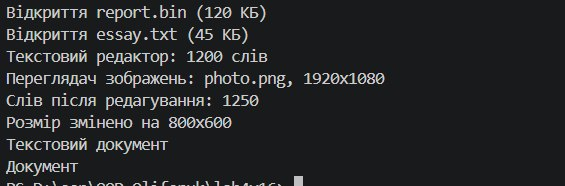

# Лабораторна робота №4: Наслідування (варіант 16)

**Тема:** наслідування, `base`, `virtual`, `override`, приховування членів (`new`).
**Студент:** Оліферук Іван, група ІПЗ-3/1

## Реалізована ієрархія

Варіант 16: `Document` → `TextDocument`, `ImageDocument`.

| Клас | Поля | Методи |
|---|---|---|
| `Document` (базовий) | `FileName`, `FileSize` (приватні поля + публічні властивості), конструктор | `virtual void Open()`, `string GetDocumentType()` |
| `TextDocument` : `Document` | `WordCount`, конструктор з `base(...)` | `override Open()`, `EditContent()`, `new GetDocumentType()` |
| `ImageDocument` : `Document` | `Resolution`, конструктор з `base(...)` | `override Open()`, `ResizeImage()` |

- **Поліморфізм:** масив `Document[]` містить об'єкти трьох типів, `Open()` виконує версію, що відповідає реальному типу об'єкта.
- **override vs new:** `GetDocumentType()` у `Document` не віртуальний, тому `TextDocument` його лише приховує через `new`. Через посилання `TextDocument` виконується нова версія, через посилання `Document` стара.

## Вивід програми

    Відкриття report.bin (120 КБ)
    Відкриття essay.txt (45 КБ)
    Текстовий редактор: 1200 слів
    Переглядач зображень: photo.png, 1920x1080
    Слів після редагування: 1250
    Розмір змінено на 800x600
    Текстовий документ
    Документ

## Відповіді на контрольні запитання

**1. Принцип наслідування. Приклад з реального світу.**
Наслідування дозволяє похідному класу отримати поля й методи базового та додати свої. Це зв'язок «є різновидом». Приклад: `Car` і `Motorcycle` є `Vehicle`, мають спільні `Brand` і `Year`, але кожен по-своєму їде. У роботі `TextDocument` та `ImageDocument` успадковують від `Document` поля `FileName` і `FileSize`.

**2. Для чого `base`.**
`base` дає доступ до членів базового класу з похідного. Використовується для виклику конструктора базового класу (`: base(fileName, fileSize)`) і для виклику базової версії методу (`base.Open()` у `TextDocument`), щоб не дублювати код.

**3. Різниця між `virtual` та `override`.**
`virtual` у базовому класі дозволяє перевизначити метод, `override` у похідному дає нову реалізацію. Під час виклику через посилання базового типу вибирається версія за реальним типом об'єкта. Це і є поліморфізм: `foreach (Document d in docs) d.Open();` працює по-різному для кожного об'єкта.

**4. Коли використовувати `new`.**
`new` приховує успадкований не-віртуальний член, коли в похідному класі потрібен метод з тим самим ім'ям, а змінити базовий клас не можна (наприклад, це чужа бібліотека). Наслідок: виклик залежить від типу посилання, а не об'єкта, тому поведінка може бути неочікуваною. У власному коді краще використовувати `virtual`/`override`.