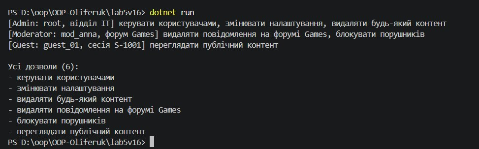

# Лабораторна робота №5: Поліморфізм (варіант 16)

**Тема:** поліморфізм, динамічне зв'язування, `virtual` та `override`.
**Студент:** Оліферук Іван, група ІПЗ-3/1
**Репозиторій:** https://github.com/Vanilin20/OOP-Oliferuk (папка `lab5v16`)

## Реалізована ієрархія

Варіант 16: `User` → `Admin`, `Moderator`, `Guest`.

| Клас | Поля | Метод |
|---|---|---|
| `User` (базовий) | `Username`, список `Permissions`, конструктор | `virtual void GetPermissions()` |
| `Admin` : `User` | `Department`, конструктор з `base(...)` | `override GetPermissions()` |
| `Moderator` : `User` | `ForumName`, конструктор з `base(...)` | `override GetPermissions()` |
| `Guest` : `User` | `SessionId`, конструктор з `base(...)` | `override GetPermissions()` |

У `Main` створено `List<User>` з об'єктами трьох похідних класів. У циклі для кожного викликається `GetPermissions()`, і виконується версія, що відповідає реальному типу об'єкта. **Агрегація:** дозволи всіх користувачів зібрані в один список і виведені в консоль.

## Запуск

    dotnet run

## Вивід програми

## Відповіді на контрольні запитання

**1. Що таке поліморфізм і як він реалізується в C# за допомогою `virtual` та `override`.**
Поліморфізм означає, що об'єкти різних класів по-різному реагують на однаковий виклик методу. У C# базовий клас позначає метод `virtual`, а похідні класи дають власну реалізацію через `override`. У нашій роботі `u.GetPermissions()` повертає різні дозволи для `Admin`, `Moderator` і `Guest`.

**2. Динамічне зв'язування і його відмінність від статичного.**
Динамічне зв'язування означає, що версію методу вибирають під час виконання програми за реальним типом об'єкта (так працюють `virtual`/`override`). Статичне зв'язування відбувається ще під час компіляції за типом посилання (так працюють звичайні методи та `new`).

**3. Приклад гнучкого й розширюваного коду.**
Щоб додати нову роль, наприклад `Owner`, достатньо створити клас, який успадковує `User` і перевизначає `GetPermissions()`. Цикл `foreach (User u in users) u.GetPermissions();` змінювати не треба, бо він працює з базовим типом.

**4. Переваги колекцій базових типів.**
В одну колекцію можна класти об'єкти різних похідних класів і обробляти їх одним циклом без перевірок типів (`if`/`is`). Код стає коротшим, а нові класи додаються без змін у вже написаному коді.