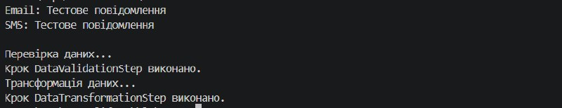

# Лабораторна робота №6

**Тема:** Абстрактні класи та інтерфейси. Контракти та реалізації.
**Мета:** Навчитися створювати та використовувати абстрактні класи та інтерфейси для визначення контрактів та реалізації спільної логіки, а також розуміти критерії вибору між ними.

---

## Хід роботи

1. Створив консольний проєкт `lab6v16` за допомогою .NET SDK[cite: 1].
2. Реалізував інтерфейс `IQueueProcessor<T>` та два класи-реалізації `EmailProcessor` і `SmsProcessor`.
3. Створив абстрактний клас `WorkflowStep` із конкретним методом `LogStepCompletion()` та абстрактним методом `ExecuteStep()`, а також похідні класи `DataValidationStep` і `DataTransformationStep`.
4. У методі `Main` створив колекції об'єктів для інтерфейсу та абстрактного класу, демонстраційно викликавши їхні методи у циклах для показу поліморфізму.

---

## Висновок

Під час виконання лабораторної роботи я закріпив навички роботи з абстрактними класами та інтерфейсами в C#. Навчився визначати контракти поведінки за допомогою інтерфейсів та виділяти спільну логіку для споріднених об'єктів через абстрактні класи, а також практично застосував принцип поліморфізму при роботі з колекціями.