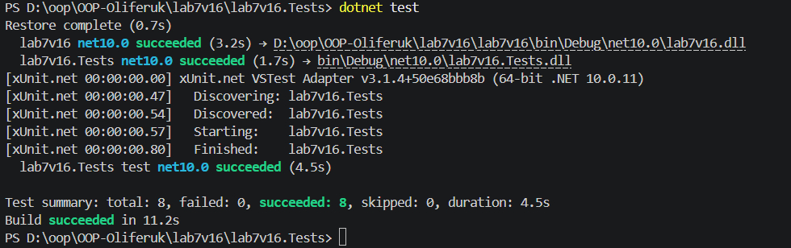

# Лабораторна робота №7
## Об'єктно-орієнтоване програмування

### Тема
Узагальнені типи (Generics). IRepository з where-обмеженнями та тестами.

### Мета
Навчитися створювати узагальнені інтерфейси та класи, застосовувати where-обмеження для типів-параметрів, а також розробляти юніт-тести для перевірки коректності узагальнених реалізацій на базі шаблону проєктування Repository.

---

### Хід роботи
1. Створено основний проєкт бібліотеки класів (`lab7v16`) для реалізації сутностей та шаблону репозиторію.
2. Створено проєкт для юніт-тестів на базі xUnit (`lab7v16.Tests`) та додано посилання на основний проєкт.
3. Реалізовано інтерфейс `IEntity` з властивістю `Id`.
4. Створено індивідуальну сутність **`BlogPost`** (Варіант 16) з властивостями `Id`, `Title`, `Content` та `AuthorId`.
5. Створено узагальнений інтерфейс `IRepository<T>` з обмеженням `where T : IEntity` та методами CRUD (`GetById`, `GetAll`, `Add`, `Update`, `Delete`).
6. Реалізовано клас `InMemoryRepository<T>` для зберігання даних в оперативній пам'яті за допомогою `List<T>` з обробкою винятків для неіснуючих елементів.
7. Написано комплекс юніт-тестів для перевірки всіх CRUD-операцій, включно з обробкою помилок.

---

### Вивід консолі (Результати виконання тестування)

Нижче наведено результат успішного проходження юніт-тестів (`dotnet test`):

*(Примітка: Усі 8 тестів виконано успішно без помилок).*

---

### Висновки
Під час виконання лабораторної роботи було закріплено навички роботи з узагальненими типами (Generics) в C# та застосування обмежень `where`. Опановано патерн проєктування `IRepository` для абстракції шару даних та розроблено надійне сховище в пам'яті (`InMemoryRepository`). За допомогою фреймворку xUnit написано автоматизовані юніт-тести, що підтвердило коректність роботи всіх CRUD-операцій та обробку виняткових ситуацій.