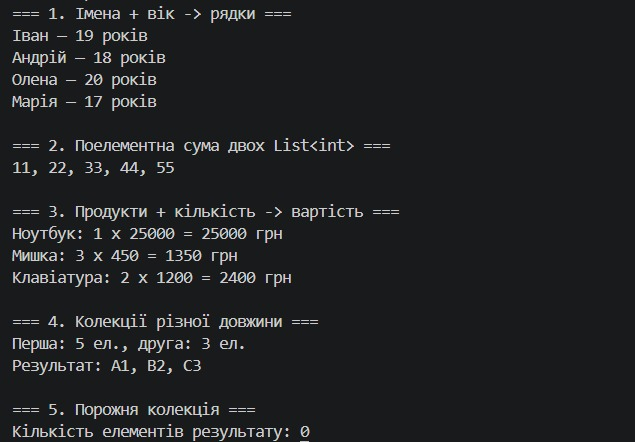

# Лабораторна робота №8
## Об'єктно-орієнтоване програмування

### Тема
Делегати й лямбда-вирази у практиці колекцій: `CollectionHelper<T>`.

### Мета
Навчитися передавати поведінку як параметр через делегати `Func`, `Action`, `Predicate`, будувати універсальні операції над колекціями та використовувати лямбда-вирази.

---

### Варіант 16 — метод `Zip`
Об'єднує дві колекції, застосовуючи `resultSelector` до пар елементів.

```csharp
public static IEnumerable<TResult> Zip<TSecond, TResult>(
    IEnumerable<T> first, IEnumerable<TSecond> second,
    Func<T, TSecond, TResult> resultSelector)
```

### Хід роботи
1. Створено консольний проєкт `lab8v16` і статичний узагальнений клас `CollectionHelper<T>`.
2. Метод `Zip` реалізовано власним кодом (без LINQ `Zip`) через два синхронні `IEnumerator`. Результат обрізається до довжини коротшої колекції, для `null` викидається `ArgumentNullException`.
3. У `Main` продемонстровано роботу з лямбда-виразами для `List<string>` + `List<int>`, `List<int>` + `List<int>`, `List<Product>` + `List<int>`, а також для колекцій різної довжини й порожньої колекції.

---

### Вивід консолі



---

### Висновки
Опановано роботу з делегатами та лямбда-виразами в C#. Метод `Zip` приймає поведінку як параметр через `Func<T, TSecond, TResult>`, тому одна реалізація працює з колекціями будь-яких типів, а логіку об'єднання зручно задавати лямбдою в місці виклику.
