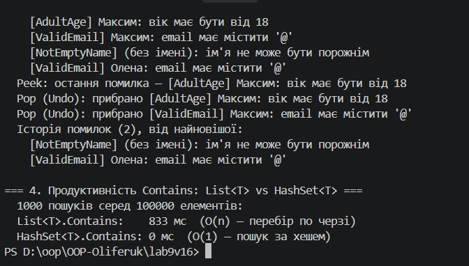

# Лабораторна робота №9
## Об'єктно-орієнтоване програмування

### Тема
HashSet/Queue/Stack: практичні сценарії.

### Мета
Навчитися використовувати спеціалізовані колекції `HashSet<T>`, `Queue<T>`, `Stack<T>` для розв'язання практичних задач, зрозуміти їхні особливості та сценарії застосування.

---

### Варіант 16 — Система валідації

| Колекція | Підзадача | Операції |
|---|---|---|
| `HashSet<ValidationRule>` | Унікальні правила валідації (дублікат за назвою не додається) | `Add`, `Contains`, `RemoveWhere` |
| `Queue<User>` | Черга об'єктів на валідацію, обробка в порядку надходження (FIFO) | `Enqueue`, `Peek`, `Dequeue` |
| `Stack<ValidationError>` | Історія помилок валідації, остання помилка зверху, відміна (Undo) (LIFO) | `Push`, `Peek`, `Pop` |

### Хід роботи
1. Створено консольний проєкт `lab9v16`.
2. Створено класи `User` (об'єкт перевірки), `ValidationRule` (правило з делегатом `Func<User, bool>`; `Equals`/`GetHashCode` перевизначено за назвою, щоб `HashSet` відсіював дублікати) та `ValidationError` (запис про помилку).
3. У класі `Validator` реалізовано методи для роботи з кожною колекцією.
4. У `Main` продемонстровано всі три підзадачі та порівняння швидкодії `Contains` для `List<T>` (O(n)) і `HashSet<T>` (O(1)).

---

### Вивід консолі

---

### Висновки
Опановано роботу зі спеціалізованими колекціями C#. `HashSet<T>` гарантує унікальність правил і дає швидку перевірку наявності, `Queue<T>` забезпечує обробку об'єктів у порядку надходження, а `Stack<T>` зручно зберігає історію помилок з можливістю відміни останньої дії. Порівняння продуктивності показало, що пошук у `HashSet<T>` значно швидший, ніж у `List<T>`.
